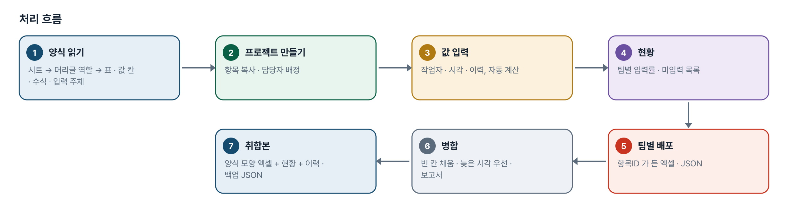
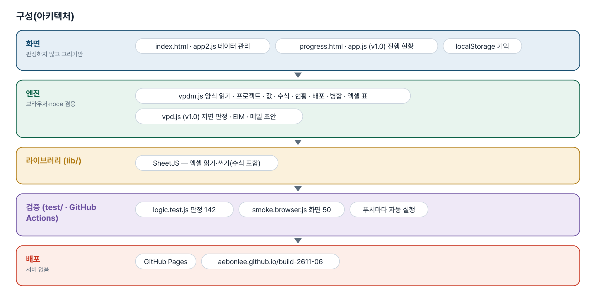
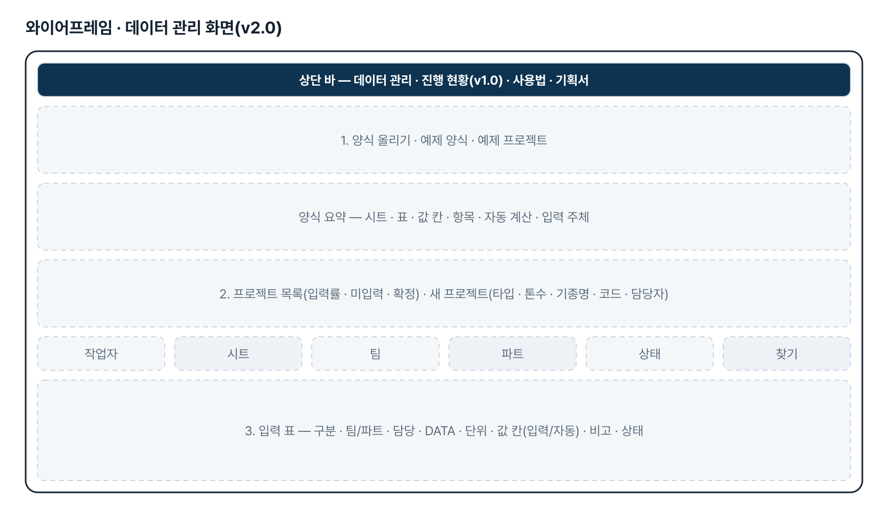
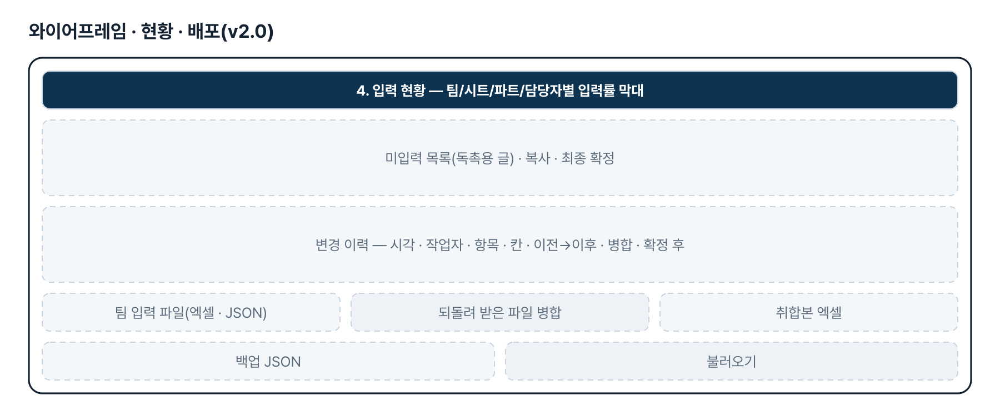
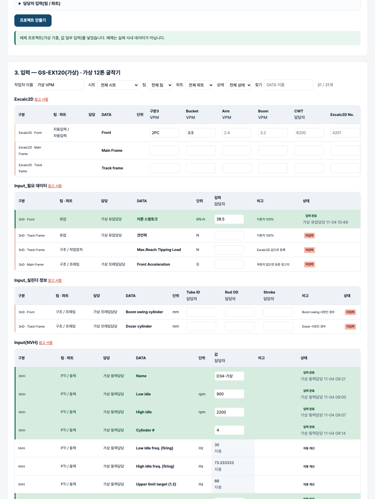

# VPD math & load 데이터 관리 — 프로젝트 기획서 v2.0

- 기획: 이정우 · 작성일 2026-11-04 · 생성형 AI 업무자동화 전문가과정 · 2차수 프로젝트 06
- 바로 쓰기: https://build-2611-06.jobability.co.kr/
- 워드 판: `docs/기획서/build-2611-06_이정우_VPDmath&load데이터관리_기획서_v2.0.docx`

## 개요

검증 진행에 쓰는 math & load 데이터 가운데 여러 팀이 함께 쓰는 값을 한 곳에서 관리하는 도구입니다. 기획자가 보낸 양식 엑셀을 올리면 기종 프로젝트마다 팀별 입력 항목이 만들어지고, 누가 무엇을 아직 안 넣었는지 보이며, 팀별 입력 파일을 나눠 주고 되돌려 받아 병합합니다. 자동 계산 칸은 양식의 수식을 그대로 따릅니다. v1.0 의 검증항목 진행 현황 도구는 「진행 현황」 메뉴에 그대로 둡니다.

### 배경 · 현재 업무
- (v2.0) 2026-11-03 기획자 요청: 「프로젝트를 해당 건에 한정하여 변경 — 검증 진행을 위한 math & load 데이터 중 여러 팀에서 공통으로 사용하는 데이터들을 DB 관리하고 취합 및 배포할 수 있는 보조 툴」. 양식 엑셀(프로젝트 생성 · Excalc2D · 필요 데이터 · 실린더 · NVH · Mass) 첨부.
- (v2.0) 값은 팀마다 다른 담당자가 넣고, VPM 이 모아 해석 팀에 넘깁니다. 엑셀 한 장을 돌려 쓰면 누가 어디까지 넣었는지, 어느 값이 최신인지 알기 어렵습니다.
- (v1.0) 가상검증 항목의 지연·임박을 판정하고 EIM 회의 요약과 요청 메일 초안을 만드는 도구(진행 현황 메뉴).

### 목표
- (v2.0) 양식 엑셀을 올리기만 하면 입력 항목(시트 · 표 · 값 칸 · 담당 팀/파트 · 자동 계산 수식)이 만들어집니다.
- (v2.0) 기종 프로젝트마다 항목을 복사해 담당자를 붙이고, 팀 · 시트 · 파트 · 상태로 걸러 값을 넣습니다. 누가 언제 무엇을 바꿨는지 남습니다.
- (v2.0) 팀별 입력률과 미입력 목록(독촉용 글)을 보고, 팀별 파일로 나눠 주었다가 되돌려 받아 규칙대로 병합합니다.
- (v2.0) 양식 모양 그대로의 취합본 엑셀과 전체 백업 JSON 을 내보냅니다.
- (v1.0) 검증항목 지연·임박 판정 · EIM 요약 · 요청 메일 초안(그대로 유지).

## 요구사항과 구현

| 기획서 요구 | 구현 |
|---|---|
| (v2.0) 공통 math & load 데이터를 DB 처럼 관리 | 양식 → 프로젝트 → 항목(시트·표·값 칸·팀/파트·담당·단위·비고·수식) 구조, 브라우저 저장 + JSON 백업. 서버 DB 는 다음 단계(§4) |
| (v2.0) 양식 엑셀(프로젝트 생성 · Excalc2D · 필요 데이터 · 실린더 · NVH · Mass · 추가 데이터 · Back up) | parseTemplate — 머리글 역할(구분·팀·파트·담당자·DATA·단위·비고·필수)로 표를 찾고 나머지 머리글을 값 칸으로. 위 줄의 「VPM입력/담당자 입력」은 입력 주체. 한 시트 여러 표 · 참고 사항 · 「추가/삭제」 끝 · 값 칸 없는 참고 표 |
| (v2.0) 프로젝트 생성(기종 타입 · 톤수 · 기종명 · 기종코드 · 생성일 · 최종확정일) · 담당자 입력(팀/파트) | createProject — 필수 칸 · 같은 코드 거름 · 팀/파트 담당자 자동 배정 · confirm 으로 최종확정일 |
| (v2.0) 자동 계산(NVH 수식) | evalFormula — 사칙연산 · 같은 시트 셀 참조 · IF 문자 비교. 참조 값이 비면 「참조 값 대기」, 모르는 함수는 「수식 미지원」 |
| (v2.0) 취합 | 진행률(팀·시트·파트·담당자별 완료·일부·미입력·자동), 미입력 목록 글, 변경 이력, 취합본 엑셀(양식 모양 + 현황 + 이력) |
| (v2.0) 배포 | 팀별 입력 파일(엑셀·JSON, 항목ID 열) → 되돌려 받아 병합: 빈 칸은 채움 · 같은 값 넘김 · 둘 다 있으면 수정시각이 늦은 쪽(시각 없으면 내 값) · 보고서 |
| (v1.0) 검증항목 진행 현황 · EIM 요약 · 요청 메일 초안 | progress.html 로 옮겨 그대로 유지 |

## 주요 기능

- **양식 올리기** — 양식 엑셀의 시트마다 표·값 칸·수식·입력 주체·참고 사항을 읽어 요약 표로 보입니다. 예제 양식(가상)도 있습니다.
- **프로젝트** — 기종 타입·톤수·기종명·기종코드와 팀/파트 담당자를 넣어 만듭니다. 목록에 입력률·미입력 수·확정 여부.
- **입력** — 작업자 이름을 적고 시트·팀·파트·상태·찾기로 걸러 값을 넣습니다. 자동 계산 칸은 수식대로 채워지고 참조 값이 비면 대기.
- **입력 현황** — 팀·시트·파트·담당자별 입력률 표, 미입력 목록(독촉용 글 복사), 최종 확정, 변경 이력.
- **배포·취합** — 팀 입력 파일(엑셀·JSON) 내려받기, 되돌려 받은 파일 병합(보고서), 취합본 엑셀, 전체 백업·불러오기.
- **(v1.0) 진행 현황** — 검증항목 엑셀 → 지연·임박·완료 판정, EIM 요약, 요청 메일 초안.

## 처리 흐름(파이프라인)

1. **양식 읽기** — 시트 → 머리글 역할 → 표 · 값 칸 · 수식 · 입력 주체
2. **프로젝트 만들기** — 항목 복사 · 담당자 배정
3. **값 입력** — 작업자 · 시각 · 이력, 자동 계산
4. **현황** — 팀별 입력률 · 미입력 목록
5. **팀별 배포** — 항목ID 가 든 엑셀 · JSON
6. **병합** — 빈 칸 채움 · 늦은 시각 우선 · 보고서
7. **취합본** — 양식 모양 엑셀 + 현황 + 이력 · 백업 JSON

## 구성(아키텍처)

- **화면** — index.html · app2.js 데이터 관리 · progress.html · app.js (v1.0) 진행 현황 · localStorage 기억
- **엔진** — vpdm.js 양식 읽기 · 프로젝트 · 값 · 수식 · 현황 · 배포 · 병합 · 엑셀 표 · vpd.js (v1.0) 지연 판정 · EIM · 메일 초안
- **라이브러리 (lib/)** — SheetJS — 엑셀 읽기·쓰기(수식 포함)
- **검증 (test/ · GitHub Actions)** — logic.test.js 판정 142 · smoke.browser.js 화면 50 · 푸시마다 자동 실행
- **배포** — GitHub Pages · aebonlee.github.io/build-2611-06

## 화면 구성(와이어프레임)

## 규칙 · 판정 기준

- (v2.0) 머리글 줄 = 「단위」와 DATA 역할이 함께 있거나 「구분1·구분2·팀」이 있는 줄. 역할이 아닌 머리글은 값 칸. 「추가/삭제」·빈 줄에서 표가 끝나고, 표 사이 글은 다음 표의 참고 사항.
- (v2.0) 수식 셀(=…)은 자동 계산 칸. 사칙연산 · 같은 시트 셀 참조(열 글자 → 그 표의 값 칸, 줄 번호 → 항목의 엑셀 줄) · IF(a="D",x,y). 참조 값이 비면 빈칸 + 「참조 값 대기」, 모르는 함수는 「수식 미지원」, 0 나누기는 「0 으로 나눔」.
- (v2.0) 상태 = 미입력(값 칸 전부 빈칸) · 일부 · 입력 완료 · 자동. 입력률 = 완료 ÷ (자동 제외 항목 수).
- (v2.0) 값 넣기는 원본을 바꾸지 않고 새 프로젝트를 돌려준다. 같은 값이면 이력에 남기지 않는다. 단위 있는 칸의 글자 값은 저장하되 경고. 자동 칸은 직접 못 넣는다.
- (v2.0) 병합: 빈 칸은 채운다 · 같은 값은 넘긴다 · 둘 다 값이 있으면 수정시각이 늦은 쪽(받은 쪽 시각이 없으면 내 값) · 다른 프로젝트 코드는 거른다 · 자동 칸은 받지 않는다. 적용한 값은 이력에 「병합(보낸 사람)」.
- (v2.0) 최종 확정 뒤의 변경은 이력에 「확정 후 변경」. 기종코드는 대소문자·공백을 무시하고 같으면 같은 코드.
- (v1.0) 지연 = 계획일 < 기준일이고 완료 아님 · 임박 = 기준일 ~ D-7 · 산출물 링크 없는 완료는 표시(그대로).

## 검증

- 계산 규칙 테스트 142개 · 화면 연기 테스트 50개 통과
- v1.0 판정 71 · 화면 22 는 그대로 두고(v1.0 화면은 progress.html 로) v2.0 판정 71 · 화면 27 를 더했습니다.
- 되돌려 확인: 머리글 판정 조건(단위+DATA)을 끄면 테스트가 멈추고, 수식 참조 대기를 끄면(빈 참조를 0 으로) 2개, 병합의 늦은 시각 우선을 끄면 2개, 같은 값 이력 생략을 끄면 1개, 자동 칸 직접 입력 막기를 끄면 1개, 담당자 배정을 끄면 2개가 실패하고, 「일부」 상태를 없애면 멈춥니다. 모두 원복 후 142 통과.
- 화면 테스트: 예제 프로젝트 → 양식 요약 9표 → 항목 수·자동 계산 값·입력률 = 엔진 계산 → 값 넣기(작업자·상태·이력·다시 열기) → 작업자 없으면 막음 → 거르기·현황 묶기·미입력 글 → 팀 엑셀 내려받아 Z 를 채워 병합(새로 채운 칸 1 · 병합 이력) → 다른 프로젝트 파일 거름 → 취합본·백업·확정 → 새 프로젝트 → 예제 양식을 엑셀(수식 포함)로 올려 읽기 → 360px → 사용법.

## 이번 판에서 하지 않는 것

- 서버 DB 가 아닙니다 — 이 브라우저와 파일에만 있습니다. 여러 사람이 동시에 고치는 공용 저장소는 사내 서버 몫이며, 이 도구는 양식 → 항목 → 팀별 배포 → 병합까지입니다.
- 수식은 사칙연산 · 셀 참조 · IF 까지만 따라갑니다. 다른 시트 참조 · SUM 등은 「수식 미지원」.
- 단위 환산과 값의 공학적 타당성은 보지 않습니다(숫자인지만).
- 양식은 엑셀에서 고쳐 다시 올립니다. 이미 만든 프로젝트의 항목은 바뀌지 않습니다.
- 기획자 양식 원본은 저장소에 없습니다 — 화면에서 올려 쓰고, 저장소의 예제 양식은 가상입니다.

## 다음 단계

- 기획자 실제 양식으로 끝까지 한 번 돌려 머리글 역할 표(ROLE)·수식 보강
- 사내 서버(공용 DB)로 옮길 때의 JSON 구조는 지금 백업 파일 그대로 — API 한 겹만 얹으면 됨
- (v1.0) 검증항목 진행 현황과 프로젝트를 잇기(기종코드로)

## 버전 이력

- **v2.0** (2026-11-04) — 기획자 요청(2026-11-03 패들릿 「Vpd math load 데이터 관리툴」)으로 주제 교체 — math & load 데이터 관리(양식 → 프로젝트 → 팀별 입력 · 현황 · 배포 · 병합 · 취합본) / 엔진 js/vpdm.js(새) · 화면 index.html · js/app2.js(새) · v1.0 도구는 progress.html 로 이동(그대로) / 테스트 판정 71→142 · 화면 23→50
- **v1.0** (2026-11-02) — 첫 판 — 판정 7종·기종/담당자 현황·EIM 요약·담당자별 요청 메일 초안·산출물 미등록·엑셀 내보내기 / 기획서 워드 판·파이프라인·아키텍처·와이어프레임 추가
